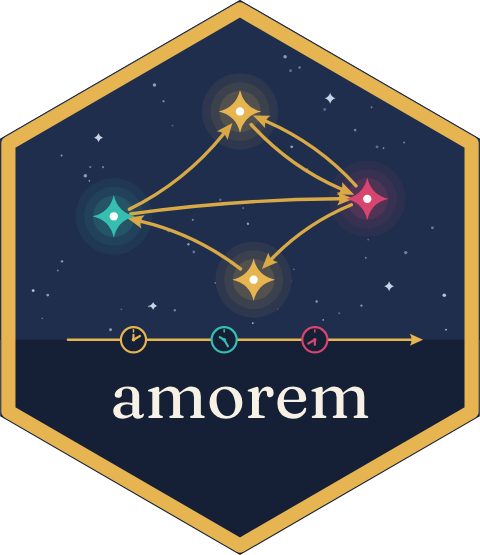

## amorem 

**amorem** — end-to-end **simulation, sampling, feature engineering,
model selection, and inference** for relational event models (REMs) in
R, in one consistent API.

The package consolidates four lines of recent methodological work:

- **Dyadic REMs** with timing / closure variants and one- or two-axis
  actor frailty, following [Juozaitienė & Wit (2024,
  *JRSS-A*)](https://doi.org/10.1093/jrsssa/qnae132).
- **Relational Hyper Event Models** (RHEMs) with set-valued
  sender/receiver hyperedges, subset-repetition covariates, and smooth
  effects (linear / `tv` / `nl` / `tvnl`), following [Boschi, Lerner &
  Wit (2025)](https://arxiv.org/abs/2509.05289).
- **Global covariate effects** — covariates varying in time but constant
  across pairs — via the time-shifted partial likelihood of [Lembo,
  Juozaitienė, Vinciotti & Wit (2025,
  *JRSS-C*)](https://doi.org/10.1093/jrsssc/qlaf058).
- **Cumulative martingale-residual GOF tests**, following [Boschi & Wit
  (2025, *Stat & Comp*
  36:4)](https://doi.org/10.1007/s11222-025-10751-2).

## Installation

``` r

install.packages("amorem")                              # CRAN release
# remotes::install_github("franciscorichter/amorem")    # development version
```

## 30-second tour

``` r

library(amorem)

# 1. Bundled datasets, ready to load
data(classroom_events)        # 691 events,    20 actors  (McFarland 2001)
data(social_evolution_calls)  # 439 events,    54 actors  (Madan et al. 2011)
data(radoslaw_email)          # 82,927 emails, 167 actors (Nurek & Michalski 2020)

# 2. Compute endogenous features post-hoc from any (sender, receiver, time) log
feat <- endogenous_features(
  classroom_events, stats = c("reciprocity", "recency"))

# 3. Simulate a ready-to-fit case-1-control table with known structure ...
w <- simulate_relational_events(
  n_events = 1500, senders = LETTERS[1:8], receivers = LETTERS[1:8],
  n_controls = 1, endogenous_stats = "reciprocity_count",
  endogenous_effects = c(reciprocity_count = 0.4), wide = TRUE)

# 4. ... and fit it with the default "gam" backend
fit <- rem(~ reciprocity_count, data = w, method = "gam")
summary(fit)
```

## What’s inside

- **[`rem()`](https://franciscorichter.github.io/amorem/reference/rem.md)**
  — the unified fitter for preprocessed case-control data, with a
  conditional-logit backend (case-*k*-control) and a `gam` backend
  (case-1-control) supporting linear / `tv` / `nl` / `tvnl` smooth
  effects and `re()` random effects, plus
  [`summary()`](https://rdrr.io/r/base/summary.html) /
  [`coef()`](https://rdrr.io/r/stats/coef.html) /
  [`plot()`](https://rdrr.io/r/graphics/plot.default.html).
  [`widen_case_control()`](https://franciscorichter.github.io/amorem/reference/widen_case_control.md)
  reshapes a long case-control log into the wide form
  [`rem()`](https://franciscorichter.github.io/amorem/reference/rem.md)
  expects.
- **[`simulate_relational_events()`](https://franciscorichter.github.io/amorem/reference/simulate_relational_events.md)**
  — exact Gillespie or τ-leap; composes exogenous, endogenous, and
  time-varying global covariates; with `wide = TRUE` emits a
  ready-to-fit case-1-control table.
- **[`endogenous_features()`](https://franciscorichter.github.io/amorem/reference/endogenous_features.md)**
  — the endogenous catalogue computed post-hoc from any
  `(sender, receiver, time)` log. On case-control data only the observed
  events build the network history; the sampled controls are scored
  against it without entering it.
- **[`sample_non_events()`](https://franciscorichter.github.io/amorem/reference/sample_non_events.md)**
  — nested case-control sampling with appearance / citation / remove
  risk-set rules, and time-shifted sampling (`shift = "exponential"`)
  that keeps global covariates estimable.
- **Datasets** — event logs from published interaction networks, and
  `enso_nino34`, a reconstructed El Niño index (1301–2005) for use as a
  global covariate.
- **Goodness of fit** —
  [`gof_rem()`](https://franciscorichter.github.io/amorem/reference/gof_rem.md)
  tests a fitted
  [`rem()`](https://franciscorichter.github.io/amorem/reference/rem.md)
  model (time, functional-form and score processes, bootstrap null that
  accounts for the estimated coefficients);
  [`gof_univariate()`](https://franciscorichter.github.io/amorem/reference/gof_univariate.md),
  [`gof_multivariate()`](https://franciscorichter.github.io/amorem/reference/gof_multivariate.md),
  [`gof_global()`](https://franciscorichter.github.io/amorem/reference/gof_global.md),
  [`gof_auxiliary()`](https://franciscorichter.github.io/amorem/reference/gof_auxiliary.md)
  refit a linear model from the event log; pointwise
  [`martingale_residuals()`](https://franciscorichter.github.io/amorem/reference/martingale_residuals.md).
- The earlier
  [`compare_models()`](https://franciscorichter.github.io/amorem/reference/compare_models.md),
  [`compare_models_smooth()`](https://franciscorichter.github.io/amorem/reference/compare_models_smooth.md)
  and
  [`compare_models_global()`](https://franciscorichter.github.io/amorem/reference/compare_models_global.md)
  remain available (superseded by
  [`rem()`](https://franciscorichter.github.io/amorem/reference/rem.md)).

## Guides

| Guide | What you’ll find |
|----|----|
| [Quick start](https://franciscorichter.github.io/amorem/articles/quick-start.md) | install + simulate-and-recover in a few lines |
| [Simulation](https://franciscorichter.github.io/amorem/articles/simulation.md) | the dyadic mechanisms, Gillespie vs τ-leap |
| [Sampling options](https://franciscorichter.github.io/amorem/articles/sampling-options.md) | the risk-set options of [`sample_non_events()`](https://franciscorichter.github.io/amorem/reference/sample_non_events.md): `n_controls`, `mode`, `scope`, `risk = "remove"`, `exclude_concurrent`, `exclude_pairs`, `shift` |
| [Endogenous catalogue](https://franciscorichter.github.io/amorem/articles/endogenous-catalogue.md) | the statistic catalogue and its variant axes |
| [Estimation](https://franciscorichter.github.io/amorem/articles/estimation.md) | case-control sampling, the three [`rem()`](https://franciscorichter.github.io/amorem/reference/rem.md) backends — `clogit` (linear), `gam` (smooth `tv`/`nl`/`tvnl`/`re` effects), `nn` (neural conditional logit) — model comparison, GOF |
| [Hyperedge models](https://franciscorichter.github.io/amorem/articles/hyperedge-models.md) | the `(I, J, time)` data model, subset repetition, multi-recipient e-mails as hyperevents, and the RHEM simulators |
| [Datasets](https://franciscorichter.github.io/amorem/articles/datasets.md) | the event logs and covariates that ship with amorem: what each one looks like, its source and licence |
| [Data catalogue](https://franciscorichter.github.io/amorem/articles/data-catalogue.md) | 78 relational event datasets and covariates, bundled or not: what each one is, its licence, code to download it, and pictures of its network and timeline; no models are fitted |
| [Analyses of bundled event logs](https://franciscorichter.github.io/amorem/articles/bundled-log-analyses.md) | models fitted to three bundled logs (classroom, company email, CollegeMsg): timing vs count statistics with and without a sender frailty, smooth effect curves |
| [Validation experiments](https://franciscorichter.github.io/amorem/articles/validation-experiments.md) | recovery, smooth, scaling, parity, and the neural backend (gradient check + interaction recovery) |
| [GoF calibration](https://franciscorichter.github.io/amorem/articles/gof-calibration.md) | type-I error of the martingale-residual GoF tests under correct specification |
| [Case study: email and the clock](https://franciscorichter.github.io/amorem/articles/case-email-global.md) | time of day and day of week as global covariates in the Manufacturing e-mail log, time-shifted sampling, cyclic smooths, `tv()` on shifted data, [`gof_rem()`](https://franciscorichter.github.io/amorem/reference/gof_rem.md), [`gof_multivariate()`](https://franciscorichter.github.io/amorem/reference/gof_multivariate.md), [`gof_auxiliary()`](https://franciscorichter.github.io/amorem/reference/gof_auxiliary.md) |
| [Case study: Social Evolution](https://franciscorichter.github.io/amorem/articles/case-social-evolution.md) | data intake, actor attributes and survey friendship as covariates, `rem(method = "clogit")`, a sender random effect with `re()` |
| [Case study: estimation backends](https://franciscorichter.github.io/amorem/articles/case-email-eu-models.md) | `clogit`, neural (`nn`, MLP and additive splines, [`nn_uncertainty()`](https://franciscorichter.github.io/amorem/reference/nn_uncertainty.md)) and `gam` with `tv()` / `tvnl()` on Email-EU-core, compared on held-out e-mails |
| [Case study: cosponsorship in the 118th Congress](https://franciscorichter.github.io/amorem/articles/case-congress.md) | bills as directed hyperevents (sponsor → cosponsor set): hypergraph, party-coloured network, chord and adjacency views; a sender- and size-matched case-control fit of repetition, reciprocity, pair co-cosponsorship, party and state, and a `tv()` party-homophily curve |
| [Case study: calls and text messages](https://franciscorichter.github.io/amorem/articles/case-copenhagen.md) | two-layer (multiplex) REM on the Copenhagen Networks Study: cross-layer history as a covariate, reciprocity and repetition per layer, gender homophily, the daily cycle as a global effect with time-shifted sampling and cyclic smooths |
| [Case study: leader visits to and from the US](https://franciscorichter.github.io/amorem/articles/case-diplomacy.md) | a star-shaped event network, 1945–2019: per-direction case-control sampling (`mode = "two"`, `scope = "appearance"`), reciprocity and inertia by direction with `rem(method = "clogit")`, the `nl()` decay of reciprocity and `tv()` inertia over 75 years |
| [Case study: armed-conflict dyads](https://franciscorichter.github.io/amorem/articles/case-conflict.md) | yearly tied events scored from earlier years only (`prior_log`), a risk set of dyads with a past; recurrence, escalation, the decay of a conflict’s pull with `nl()`, and a `tv()` effect |
| [Case study: international football](https://franciscorichter.github.io/amorem/articles/case-football.md) | matches since 1872 as undirected events: rivalry network with regional groups, recency smooth, common opponents (triadic closure), friendlies against competitive matches |
| [Case study: first records of alien species](https://franciscorichter.github.io/amorem/articles/case-invasions.md) | observed species-to-region first records with `mode = "two"`, `risk = "remove"`, `prior_log` and time-shifted sampling; shared-invader network, timing heatmap, taxonomy by group, ENSO (ONI) as a global smooth |
| [Species invasions](https://franciscorichter.github.io/amorem/articles/species-invasion.md) | a one-shot (`risk = "remove"`) process with ENSO as a global driver, fitted by time-shifted sampling |

Full per-function documentation is under
[Reference](https://franciscorichter.github.io/amorem/reference/index.md).

## References

- Juozaitienė R., Wit E.C. (2024). *It’s about time: revisiting
  reciprocity and triadicity in relational event analysis.* JRSS-A
  188(4), 1246–1262.
  [doi:10.1093/jrsssa/qnae132](https://doi.org/10.1093/jrsssa/qnae132).
- Boschi M., Lerner J., Wit E.C. (2025). *Beyond Linearity and
  Time-Homogeneity: Relational Hyper Event Models with Time-Varying
  Non-Linear Effects.* arXiv:2509.05289.
- Lembo M., Juozaitienė R., Vinciotti V., Wit E.C. (2025). *Relational
  Event Models with Global Covariates.* JRSS-C.
- Boschi M., Wit E.C. (2025). *Goodness of fit in relational event
  models.* Statistics and Computing 36(4).
